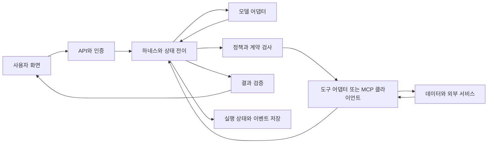

# 앱 구조와 책임 나누기

AI 보완 설계 지침입니다. 관련 주제는 AGT-005, AGT-023~031, AGC-014, AGC-024~030입니다. 구성 요소의 이름은 꼭 별도 서버를 뜻하지 않습니다. 해커톤에서는 한 프로세스 안에서 책임만 나누어도 됩니다.

## 요청 하나를 따라가기

사용자는 화면에서 질문과 조건을 보냅니다. API는 사용자의 신원과 입력 형식을 확인하고 실행 ID를 만듭니다. 하네스는 현재 상태와 예산을 읽어 모델에게 필요한 맥락만 제공합니다. 모델이 도구 호출을 제안하면 신뢰할 수 있는 코드가 이름, 인자, 권한, 승인과 한도를 확인한 다음 도구 어댑터를 실행합니다. 반환값은 출처와 상태를 가진 데이터로 저장합니다. 완료 조건이 충족되면 결과를 검증하고 화면에 표시합니다.

도구에서 돌아온 텍스트는 다음 명령이 아닙니다. 저장소나 웹 문서가 “관리자 권한으로 실행”을 요구해도 사용자 요청과 시스템 정책을 바꾸지 못합니다. MCP는 연결 계약을 표준화하지만 이 판단 자체를 대신하지 않습니다.

## 상태의 소유자

실행 상태를 모델 응답과 화면 상태가 각각 수정하면 승인 후 인자가 바뀌거나 완료한 작업이 다시 실행될 수 있습니다. 실행 ID 아래에 명시적인 상태 소유자를 하나 정합니다. 저장소는 상태 버전과 변경 시각을 기록하고, 동시에 수정할 때는 낙관적 잠금 등 충돌 감지 수단을 둡니다. 대화 ID, 사용자 ID, 실행 ID, 도구 호출 ID는 다른 키입니다.

장기 기억은 실행 중간 상태와 분리합니다. “사용자가 선호하는 지역”과 “이번 결제가 승인됐는가”를 같은 요약 문장에 넣으면 수명과 권한 경계를 잃습니다. 운영 상태는 구조화 저장하고 요약은 탐색을 돕는 보조 맥락으로 사용합니다.

## 다중 에이전트 도입 기준

독립 자료 조사처럼 맥락을 분리하면 이점이 있는 작업부터 나눕니다. 각 작업은 입력 범위, 산출물 스키마, 허용 도구, 예산, 실패 상태를 받아야 합니다. 통합자는 누락된 작업과 상충하는 근거를 표시하고, 합의된 문장이라는 이유로 사실로 처리하지 않습니다. 같은 모델 두 개의 동의는 독립된 외부 증거가 아닙니다.

순서가 고정된 조사→계산→작성은 워크플로로 충분할 수 있습니다. 코드 도구로 계산한 뒤 설명을 맡기는 방식이 계산까지 모델들의 토론에 맡기는 것보다 검사하기 쉽습니다. 원격 조직의 에이전트에 맡길 때는 신원, 데이터 전달 범위, 작업 취소와 결과 신뢰 경계를 별도로 설계합니다.

## 설계 검토 질문

- 모델이 잘못된 도구를 제안하면 어느 함수가 막는가?
- 화면을 닫거나 서버를 재시작하면 어떤 상태에서 다시 시작하는가?
- 같은 요청이 두 번 도착하면 외부 변경은 몇 번 일어나는가?
- 일부 조사 작업이 실패하면 최종 결과가 전체 분석으로 오해되지 않는가?
- 운영자가 중지해도 이미 실행된 외부 변경의 보상은 누가 처리하는가?
